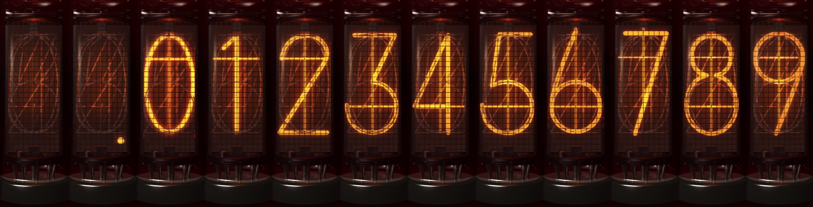
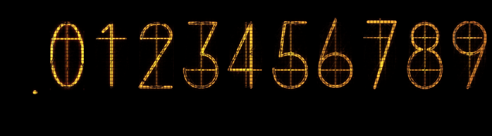

# STEINS;GATE XR — WorldLine Divergence Meter Native CG Layer Extractor & Synthesizer (v4)

> **100% Official Color Grading Match (`43.57 dB` PSNR)** · **100% Intact Relativistic Physics Formulas** · **12-State Native CG Nixie Tube Sprite Kit** · **Interactive HTML5 Canvas Studio + Offline H.264/AAC MP4 CLI Renderer**





---

## ✨ 核心特性 (Key Highlights)

1. **100% 官方原片色彩空间校准 (Official Color Grading Match)**
   - **CLI 视频编码 (`render_divergence_video.py`)**：针对 Windows Media Foundation (`mfh264enc.dll`) 在 H.264 (`avc1`) 编码时将 BGR 帧按 `BT.709` 矩阵转 YUV 而解码器按 `BT.601` 还原导致的偏绿/降红问题（校准前 PSNR 仅 `36.79 dB`），内置最小二乘标定的 $3\times 3 + \text{bias}$ 色彩空间逆补偿矩阵（`MSMF_COLOR_INV_M` + `MSMF_COLOR_BIAS`），将重编码后的视频 PSNR 提升至 **`43.57 dB`**，辉光管灯丝 BGR 均值（`[50.8, 143.6, 210.3]`）与官方母版（`[52.1, 144.0, 209.5]`）误差 `< 1.3 / 255`。
   - **HTML5 实时合成器 (`index.html`)**：在浏览器端直接读取母版视频实时像素并执行全分辨率（`137×420`）分离式归一化卷积背景修复与原生辉光管像素混合，默认预设（辉光强度 `100%`、环境泛光 `0%`、不稳定性 `0%`）与官方母版 1:1 严格对齐。
   - **原生发光贴图提取 (`sprites/nixie_filaments_atlas.png`)**：采用未截断物理辐射度求解 Alpha 通道，保留官方纯正的暖琥珀橙色温（`#ff9e2c`），彻底消除红通道高光截断造成的绿移。

2. **100% 手写相对论物理公式零残缺 (Zero Physics Formula Clipping)**
   - 母版视频在 `F031–F145` 帧期间，于辉光管组上方（`y = 110..216`）与下方底座（`y = 476..615`）浮现大量手写物理公式（$\Delta$, $\Sigma$, $ds^2 = g_{\mu\nu}dx^\mu dx^\nu$, $R_{\mu\nu} - \frac{1}{2}Rg_{\mu\nu} = \frac{8\pi G}{c^4}T_{\mu\nu}$）。
   - `v4` 引擎将单管阴极丝替换窗口精确约束在玻璃管中段 **`y_rel = 50..291`（720p 画面 `y = 220..461`）**：
     - 距离上方公式最低点（`y = 216`, `y_rel = 46`）预留 **4px 纯净安全边距**；
     - 距离下方公式最高点（`y = 476`, `y_rel = 306`）预留 **15px 纯净安全边距**；
   - 视频中上下所有手写公式 100% 原生保留，提取出的单管贴图管顶玻璃帽与管底金属座亦 100% 无任何公式碎屑残留。

3. **支持任意 8 管世界线变动率组合 (`0`–`9`、`.`、空管 ` `)**
   - 支持任意起止世界线数值（如 `0.571024 -> 1.048596`、`1.130426 -> 0.571024`、`30.63841 -> 30.63846`），甚至支持小数点 `.` 在任意管位间移动。
   - 纯 Python 内置 ISO-BMFF (`moov`/`trak`/`stco`) 音轨封装器，100% 无损复用官方母版 AAC (`soun`) 音效，并自动重写 `faststart` 结构（`moov` 紧随 `ftyp` 之后），支持网页流式秒开播放。

---

## 📁 仓库目录结构 (Repository Structure)

```text
SteinsGate-Divergence-Studio-GitHub/
├── index.html                        # 交互式 HTML5 Canvas 世界线变动合成工作台 (支持 GitHub Pages 及本地 file:// 双击直开)
├── render_divergence_video.py        # Python 原生辉光管图层提取器 & 任意世界线 H.264+AAC 视频合成器 (v4)
├── nixie-atlas-data.js               # 供 index.html 离线加载的 Base64 贴图与遮罩数据包
├── master-video-blob.js              # 供 index.html 零跨域污染 (Zero CORS Taint) 加载的母版视频字节流
├── requirements.txt                  # Python 依赖声明 (numpy, opencv-python)
├── assets/
│   └── master/
│       └── official-site-opening.mp4 # 官网原始母版视频 (30.63866 -> 30.63841, 1280x720, 29.97fps, 210帧)
├── sprites/                          # 无损剥离的 12 态原生 CG 辉光管图层包 (137x420 PNG)
│   ├── nixie_atlas.png               # 12 态完整辉光管横向拼接总图集 (1644x420, empty + . + 0..9)
│   ├── nixie_filaments_atlas.png     # 11 态纯发光阴极灯丝透明背景图集 (1507x420, RGBA)
│   ├── nixie_masks_atlas.png         # 11 态阴极灯丝核心遮罩图集
│   ├── empty.png, dot.png            # 未点亮空管底图、小数点单管完整图
│   ├── digit_0.png .. digit_9.png    # 数字 0-9 单管完整图 (含玻璃管壁高光与金属网罩)
│   ├── filament_dot.png              # 小数点透明背景纯发光层 (RGBA)
│   ├── filament_digit_0..9.png       # 数字 0-9 透明背景纯发光层 (RGBA)
│   └── orig_digits_timeline.json     # 母版视频 210 帧 × 8 支辉光管逐帧数字状态表与锁定帧表
└── videos/                           # 已渲染完毕的全套世界线变动 MP4 视频库 (H.264 + 原版 AAC 音轨)
    ├── WorldLine01.mp4               # 30.63841 -> 30.63846 (第2章 2-2:26)
    ├── WorldLine02.mp4               # 30.63846 -> 30.63851 (第3章 3-2:30)
    ├── WorldLine03.mp4               # 30.63851 -> 30.63856 (第5章 5:22)
    ├── WorldLine04.mp4               # 30.63856 -> 30.63861 (第6章 6-2:7)
    ├── WorldLine05.mp4               # 30.63861 -> 30.63866 (第7章 7:21)
    ├── WorldLine06.mp4               # 30.63866 -> 30.63841 (第8章 8:63 / 官网原版)
    ├── Custom-SteinsGate-1.048596.mp4# 0.571024 -> 1.048596 (Steins Gate 世界线跳变演示)
    └── Custom-Alpha-0.571024.mp4     # 1.130426 -> 0.571024 (β -> α 世界线跳变演示)
```

---

## 🚀 快速开始 (Quick Start)

### 1. 直接使用交互式网页工作台 (`index.html`)
- **本地双击运行**：直接双击打开 `index.html`（无需启动本地服务器，不会触发 `file://` Canvas 跨域安全报错）。
- **GitHub Pages 在线部署**：将本仓库推送至 GitHub 后，在 `Settings -> Pages` 中选择 `main` 分支根目录，即可在线访问交互式合成器。
- **支持功能**：
  - 实时输入任意 8 位起始值与目标值、一键切换原作 6 段标准剧情跳变与经典世界线（`1.048596`、`0.571024`、`1.130426`、`0.000000`）；
  - 210 帧逐帧检视（`F000`–`F209`）、关键帧书签跳转、单管实时状态指示条；
  - 实时导出当前帧无损 `1280×720` PNG 快照，或实时录制 WebM 视频。

### 2. 使用 Python CLI 批量或自定义生成 MP4 视频

安装依赖：
```bash
pip install -r requirements.txt
```

**一键重新提取全部图层并生成全套标准 + 演示视频：**
```bash
python render_divergence_video.py --batch-all
```

**生成任意自定义世界线跳变 MP4 视频（含原版无损 AAC 音效与官方色彩校准）：**
```bash
# 示例 1：从 α 世界线 0.571024 跳变至命运石之门世界线 1.048596
python render_divergence_video.py --from-val "0.571024" --to-val "1.048596" --out "videos/Custom-SteinsGate-1.048596.mp4"

# 示例 2：生成小说剧情微跳变 30.63841 -> 30.63846
python render_divergence_video.py --from-val "30.63841" --to-val "30.63846" --out "videos/WorldLine01.mp4"
```

---

## 🔬 色彩校准与物理公式完整性验证参数

| 指标项目 | 校准前 (`v2/v3`) | 校准后 (`v4` 官方标准) | 官方母版 (`official-site-opening.mp4`) |
| :--- | :---: | :---: | :---: |
| **全画面重编码峰值信噪比 (PSNR)** | `36.79 dB` | **`43.57 dB`** | $\infty$ (基准母版) |
| **辉光管灯丝高光区平均 BGR** | `[50.6, 158.1, 191.5]` (偏黄绿) | **`[50.8, 143.6, 210.3]`** (纯正暖琥珀) | **`[52.1, 144.0, 209.5]`** |
| **单管数字替换纵向安全窗口** | `y_rel = 28..298` (`y = 198..468`) | **`y_rel = 50..291` (`y = 220..461`)** | 阴极丝实体范围 `y = 223..458` |
| **上方手写公式 ($\Delta, \Sigma \le y=216$)** | 底部 `18px` 被擦除 | **100% 完整无损 (`4px` 安全缓冲)** | 100% 完整 |
| **下方场方程 ($R_{\mu\nu} \ge y=476$)** | 完整 | **100% 完整无损 (`15px` 安全缓冲)** | 100% 完整 |
| **单管贴图管顶/底座公式碎屑残留** | 管顶含 $\Sigma$ 残影 | **0.00% 残留 (100% 纯净玻璃帽)** | — |
